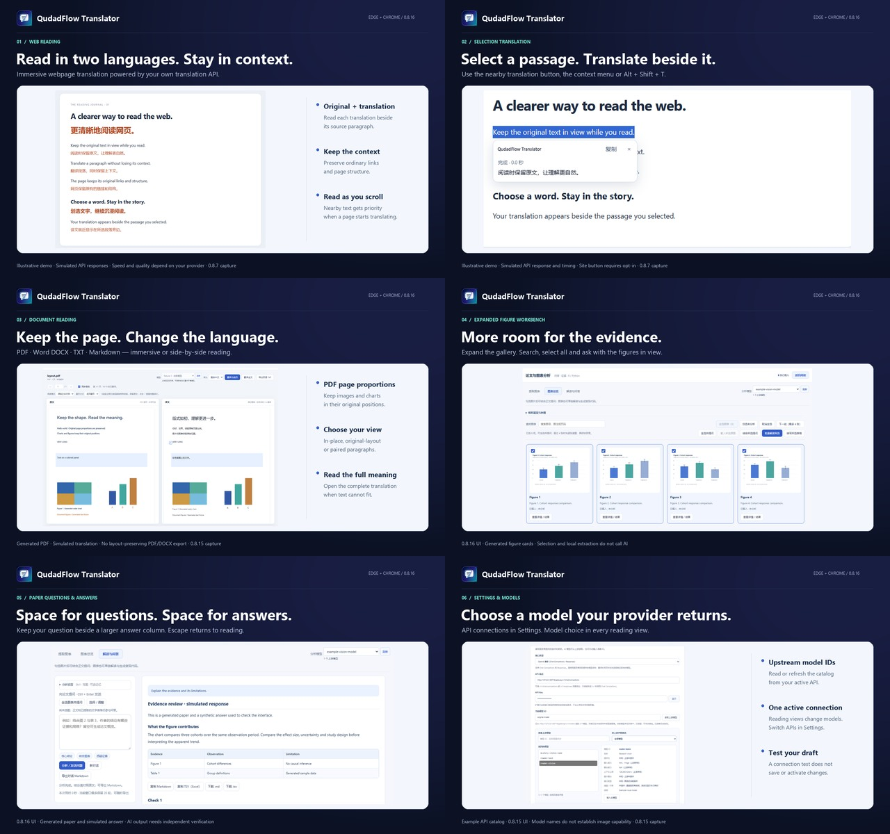

# QudadFlow Translator

**Version 0.8.16:** paper and PDF/Word/TXT/Markdown figure workbenches can expand into a dedicated viewport with larger previews, accessible bulk controls and separate question/answer columns. Layout changes retain selections, drafts and pending analyses. See [release notes](docs/RELEASE_NOTES_0.8.16.md) and [publication status](docs/STORE_SUBMISSION_0.8.16.md).

A Manifest V3 extension for Microsoft Edge and Google Chrome, with immersive bilingual webpages, selection translation, and in-place document translation for PDF, Word DOCX, TXT, and Markdown. Traditional translation APIs and AI both power the base reading features. Vision AI adds an optional picture/chart workflow at the bottom.

**0.8.15** adds automatic upstream model discovery in every reading view, plain model-ID lists and Settings-only API connection switching. PDF reading now offers page-by-page or continuous navigation, caption-aware figure/table extraction and an optional AI review workflow inside the compact figure overview. See [release notes](docs/RELEASE_NOTES_0.8.15.md) and [publication status](docs/STORE_SUBMISSION_0.8.15.md).

[Website](https://qudadd.github.io/qudadflow-translator/) · [Privacy policy](https://qudadd.github.io/qudadflow-translator/privacy.html) · [中文网站指南](https://qudadd.github.io/qudadflow-translator/zh-CN.html) · [中文 README](README.zh-CN.md)

**QQ community: 1048123205** — search for this group number in QQ to join, share feedback and discuss the extension. You can also find it in the extension popup and Settings → 交流与支持.

[](docs/STORE_PRESENTATION_0.8.16.md)

The [store presentation](docs/STORE_PRESENTATION_0.8.16.md) includes current English/Chinese descriptions and six screenshots. Generated fixtures, simulated API responses and capture versions are labeled; provider quality and speed vary.

GitHub and store submission states are recorded separately in the [0.8.16 publication record](docs/STORE_SUBMISSION_0.8.16.md). Store submission does not establish approval.

## Translation providers

- Google Cloud Translation v2
- DeepL API (Free and Pro endpoints)
- Microsoft Translator (Azure)
- OpenAI-compatible Chat Completions and Responses, including streamed text
- Custom JSON APIs with request templates and response paths
- MyMemory: a key-free basic trial using its documented public GET API, with a typical anonymous allowance of 5,000 characters/day

Bring your own API credentials. Provider accounts, charges, availability, retention policies, and translation quality depend on the provider you choose. The extension does not include a translation subscription or developer-operated proxy. The current extension interface is in Simplified Chinese.

## Saved configurations and basic trial

Settings can keep up to 20 named configurations, including provider, endpoint, key, model, headers, and language preferences, in browser-local storage. An existing configured connection is preserved on first use. Select a saved configuration to edit it, then Save to apply; **新增 API 配置并使用** creates a separate scheme and retains the previous one. Only Settings can switch API schemes. The popup selects models on the active API. Deleting an active scheme also clears its live connection; other saved schemes retain their own keys. Profile names and metadata are shown in the selector, never keys. This is configuration history, not a record of translated content.

For a quick start, choose **启用 MyMemory 基础试用** in Settings and allow its API domain. No key or account is needed. It starts with English → Simplified Chinese; choose a source language explicitly for other text. MyMemory combines translation-memory matches and machine translation. The extension sends one paragraph per request, splitting at 480 UTF-8 bytes, preserves internal paragraph markers locally, and stops on quota errors. It does not call contribution/upload endpoints or silently switch providers. Requests use HTTPS query parameters, without provider keys or source-site cookies.

The free public service is quota-limited and may retain submitted text long-term; use it for non-private short samples. See [API documentation](https://mymemory.translated.net/doc/spec.php), [usage limits](https://mymemory.translated.net/doc/usagelimits.php), and [terms/privacy](https://mymemory.translated.net/terms-and-conditions). No free unlimited public API is promised. For extensive reading, use your own provider or self-host a compatible translation service.

## Choose an upstream model (0.8.15)

Settings groups saved configurations, connection/model selection, translation preferences, research memory and support in a responsive sidebar layout. For OpenAI-compatible services, enter your endpoint, key and optional headers, then click **读取上游模型**. This explicitly requests a same-origin models route derived from your endpoint (normally `/v1/models`), without page text. The detailed discovery response stays in the settings tab. A compact list of up to 1,000 model IDs and declared modalities is saved locally for reading-page selectors, together with a fetch time and a digest of the connection. Up to 20 connection catalogs fit within a 2 MB budget; oldest catalogs are evicted. A changed endpoint, key or custom headers selects a different catalog. On first opening a reading view with a configured AI connection and no cached catalog, discovery runs automatically using that saved connection and existing host permission. Reading views offer inline Refresh/Cancel. Simultaneous views share one request. Cached lists do not trigger repeated reads; an error or empty list preserves the current model and requires an explicit retry for that worker session. A missing host grant directs you to Settings. No draft credentials from a reading view are accepted. Discovery has no extension deadline; cancel loading at any time.

Each settings section folds independently, with **收起全部 / 展开全部** controls. Fold preferences stay locally in this browser. Navigation opens its target section without changing the saved API connection.

Search returned IDs, filter reported text/image capabilities, inspect metadata, then click **填入此模型**. Discovery never selects a model automatically or replaces an existing value. After discovery, the popup, document toolbar and paper/figure workbench can switch the shared active model. Only the model changes; API address, key and headers remain the Settings choice. Switching stops active work and synchronizes other open views. The active saved scheme also remembers the model. A manual model absent from the returned list is retained, but new IDs must come from that connection's catalog or be entered in Settings. Reading dropdowns show model IDs only; the Settings metadata panel can show unknown values. Names alone do not establish capabilities; names alone do not establish vision support, speed, cost or quality. Some gateways do not expose model lists; use an ID from their documentation in that case.

**测试连接** tests the current unsaved draft with a fixed short sentence and reports elapsed time. It bypasses the cache, does not save/apply the draft, and does not validate image input. It can request persistent access to that API host. **停止测试** aborts a pending test; closing or leaving its settings tab cancels its model/test requests. Click **保存设置** to apply. Editing the connection invalidates previous discovery and verification results.

## Install for development

1. Open `edge://extensions` (Edge) or `chrome://extensions` (Chrome) and enable **Developer mode**.
2. Choose **Load unpacked** and select this repository folder.
3. Open the extension options, select your provider, enter the endpoint and API key, and save.
4. Allow access to the API domain and use **Test connection**.
5. Open a normal webpage and choose **沉浸式翻译当前网页** (immersive translation).
6. For the nearby selection button, enable **在此网站启用划词翻译按钮** in the popup and approve access to that site. Select text, then click **翻译**. Press Esc to close. This opt-in persists for that site; selecting alone never sends text.

Under **网站与 API 访问权限**, **一次授权所有网站** explicitly requests persistent HTTP/HTTPS access for pages, original images and APIs. This allows the extension to read those sites and reduces later permission dialogs; it does not enable selection buttons on every site. **恢复按站点授权** clears optional website grants, including existing individual/API grants, so they can be requested again when needed.

Browser-internal pages and restricted store pages cannot host the webpage translation interface. When you first open the popup on an ungranted website, it shows a current-site authorization reminder. Clicking **授权当前网站** requests that HTTP(S) host on all ports inside the browser confirmation gesture; opening the popup itself does not request permission. The compact card folds its detailed explanation; denial/cancellation leaves a retry, consent hides it immediately, and reopening a granted site leaves no placeholder. The check uses actual browser grants, so revocation makes the reminder appear again. Protected browser/store pages omit this card. Authorization does not start translation or enable selection buttons. File-URL access is a separate browser extension-detail setting. For a PDF open in Edge, use **PDF / 文档左右对照** in the popup to open the separate document reader. Page-panel extraction is limited to 12,000 characters per action; immersive translation has no fixed paragraph or body-character cap.

## Reading preferences (0.8.7)

In Settings → **翻译偏好**, choose an immersive text color using the picker or a six-digit HEX value. Light/dark previews and **恢复默认** are available. The color applies immediately to existing webpage and in-place document translations, preserving originals, compare-mode colors and document geometry. Color is saved locally, independently of API configurations, and does not trigger translation or clear the translation cache.

**网页沉浸式快捷键** defaults to **Shift+A**. Type a combination and click **保存快捷键**, or use **录制快捷键**. Ctrl/Alt/Shift/Meta combinations, letters, digits, punctuation, navigation keys and F1–F12 are supported with validation; standalone function keys are also accepted. Esc, Tab, blur or the cancel button cancel recording. Reset or disable at any time. The old unversioned Ctrl+A default migrates to Shift+A; explicitly saved combinations remain. It works in already authorized HTTP/HTTPS page bodies and excludes inputs/editors. Browser-reserved combinations may be unavailable. The browser command **Alt+Shift+I** remains available.

## Immersive documents

Open **PDF / 文档左右对照** from the popup or the document command in the page/link context menu. Open the prefilled HTTP(S) document URL after granting its source host, or choose/drop a local file. Download authenticated or blob documents first if the reader cannot fetch them. Opening a document sends no translation request.

- **沉浸原位 — In-place immersive:** PDF preserves the original page ratio and keeps images/vector charts in position. Translated text replaces the source text region. Long or unsupported text retains its original and a clickable full-translation link; nothing pushes later content down. Click a translation to inspect its original. **查看原文** toggles the source page.
- **原版左右对照 — Original-layout comparison:** original and translated pages appear side by side at the same scale. **段落对照 — Paragraph comparison:** reflows text for comfortable reading and height-aligns corresponding paragraphs.
- For PDF, **翻页方式** switches between **逐页翻页** and **连续阅读**, saved locally. Continuous reading tracks the current page, pairs original/translated scroll anchors and keeps only nearby rendered pages in memory. Page controls still jump to a page; translating all pages starts at the current page and reprioritizes after navigation when the next page can begin.
- Word DOCX renders pages, tables, embedded raster images, margins and text locally. Translation overlays stay in the measured paragraph regions. Browser fonts and complex Word layouts can differ from Microsoft Word; use a PDF when strict layout fidelity is needed. TXT and literal Markdown retain their reading-paragraph positions in immersive mode, not original file pagination.
- Translate the current page or all pages with **either traditional MT or AI**. Two requests at most per reader, streaming when supported, stop/resume and bilingual TXT export are available. Export does not generate a layout-preserving translated PDF or DOCX.

### Compact figure workbench

Extraction, overview, answers and temporary candidate review occupy one tabbed area. In the PDF reader the expanded body is limited to 34% of viewport height, and collapses to one header row. AI page options and manual import/crop tools are folded by default. AI configuration, task status and Stop stay shared; selecting a tab preserves material and results.

1. Choose and save the active API in Settings. For AI figures, that API and the selected model must support image input. Traditional providers still translate body text, but they do not activate AI analysis through an unrelated saved connection.
2. Expand **图表工作台 → 提取图表** at the bottom. **提取全文图表** at the top checks PDF pages sequentially with progress and Stop, including while a body translation API is pending. **提取本页图表** checks only the current page, using captions and local raster/vector drawing coordinates. An empty current page does not establish an empty document. Numbered captions anchor the crops; repeated headers/footers and anonymous raster artwork are excluded. Whole-document extraction links nearby-page captions, split panels and matching ruled-table continuations. Native PDF tables are reconstructed into copyable Markdown/TSV and included in paper Q&A. Word image extraction remains available. Use **框选图表**, **提取整页** or screenshot import for missed content. Preview, download or remove the extracted images before analysis.
3. Choose a model on the current API; API schemes can only be changed in Settings. Click **翻译图文并解释**, or analyze the unfinished images. This action sends the selected image(s), target language and analysis instructions to that AI endpoint. Results stream as text; stop at any time. Image analysis does not rewrite chart artwork or replace scanned-page text.

For missed figures, expand **图表总览 → AI 补充识别** inside the same workbench. Select an image-capable model on the active API and enter page numbers such as `13-18` or `13,15,17`; blank means the current page. **识别并预览** sends those page images, including body text, extracted page text and image dimensions sequentially to that endpoint. No automatic AI fallback occurs. Declared fractional, normalized, percentage, pixel and corner-coordinate formats are validated and converted; ambiguous corner inference requires manual selection. Invalid candidates are reported without discarding valid neighbors. A page with unusable JSON or coordinates and no valid crops receives one corrective request using the same image; a still-unusable page is reported and processing continues. Actual API/HTTP errors stop subsequent requests immediately. Expand the result details or use **重试问题页** to explicitly rerun affected pages. The **核对候选** tab shows successful crops without a modal or backdrop, including after a partial failure; use **查看原页** to compare. Review and select crops before adding; uncertain or changed crops start unchecked, and confirmed replacement clears the old analysis/code drafts. Local and AI results share page, identity and crop-overlap deduplication. Repeated/unnamed table boxes and slightly shifted reruns no longer create separate cards. Conflicting overlapping labels require manual review; a more complete crop can explicitly replace the existing item. Genuine continued tables on different pages remain separate. The localisation request includes existing page-crop labels and normalized coordinates to help avoid duplicate extraction. Confirming or cancelling returns to the gallery. Stop cancels the current request; configuration/document changes dismiss stale previews and document replacement clears diagnostics. Image tables can then use **提取可复制表格** for an unverified AI transcription.

Images are bounded to a 1,600-pixel longest edge, 4 MB encoded per image, and 40 loaded images/32 MB total. Document images stay in tab memory and bypass the text cache. Analysis results may be retained when optional research memory is enabled. Downloaded images and exported TXT persist in your chosen folder. Opening files and local picture extraction do not call AI. Check AI transcriptions and numerical explanations against the original.

Caption/drawing detection is heuristic and can miss unlabelled, scanned or complex figures. PDF text-table reconstruction is explicitly unverified: check rows, columns, empty cells, merged headings and notes against the original. It does not provide OCR. An explicitly headed, complete ordered figure-legend list can now match an exact contiguous sequence of later graphics pages; ambiguous or incomplete sequences are not guessed. The 46-page reference yields five main figures and four Table 1 page segments. Rotated watermark text is excluded from copyable table cells, and continued pages avoid duplicate headers. The 42-page sample yields Figures 1–4 and Tables 1–2 as 17 page segments, including the ten-page Table 1. The 10-page regression sample still yields four figures and one 24-row, six-column table. Local extraction calls no API. Section-numbered, unruled supplementary tables in the 42-page sample still need AI or manual supplementation. Some reference figure plates are already clipped by the source PDF page boundary; extraction cannot restore invisible content. Private PDFs, fixtures and screenshots are excluded from repository packages. AI workflow checks use manually annotated simulated responses, not a real-model accuracy evaluation.

Files are limited to 25 MB; PDF and rendered Word documents retain a 300-page resource bound. TXT/Markdown reading sections and extracted body text have no fixed character cutoff. Text must be UTF-8 or BOM-tagged UTF-16. Old .doc, spreadsheets and presentations are unsupported. Scanned PDFs need external OCR for body replacement; the optional vision workflow can inspect a page image. Complex columns, overlapping text, equations, unusual encodings and special fonts can require the paragraph mode or manual checking.

PDF.js, fflate, docx-preview and JSZip are bundled locally, with no CDN or remote executable code. The browser parses files locally. Body translation sends extracted text; optional figure localisation sends selected page images/text, and analysis sends chosen crops. Original PDF/DOCX file bytes and passwords are never sent to translation APIs. Requires Chromium-based Edge 125+; checks run on Edge 155. See [third-party notices](THIRD_PARTY_NOTICES.md).

For OpenAI-compatible services, enter a full `/v1/chat/completions` or `/v1/responses` endpoint and a model supported by that service. A domain or `/v1` base URL defaults to Chat Completions. Streaming is enabled by default; turn it off if your gateway does not support it. Leave Temperature empty to use the provider default. Translation, model discovery, connection tests and AI paper/figure/code analysis have no extension-imposed deadline. Actual HTTP/network/stream failures stop the request; Stop cancels it manually. HTTP errors are reported immediately without waiting for an error body or automatically retrying rejected parameters. Old timeout preferences are ignored. Providers and browser/network infrastructure may still impose limits. Separate document/image downloads retain resource safeguards.

Immersive translation streams into each paragraph and prioritizes the viewport. It scans the page body, open shadow roots and accessible same-origin frames, including short labels, while skipping editable, hidden and opted-out content. The scan yields periodically to keep the page responsive; paragraphs use bounded batches and two concurrent requests. Browser-local language detection skips confidently identified target-language text, with conservative handling of mixed Chinese/Japanese text. While enabled, scrolling, expanding, inserting or editing content triggers supplementation. Closing the panel, restoring the original, changing configuration or navigating stops supplementation. Original text nodes and link identity survive restoration. Bilingual text increases paragraph height; fixed-height layouts, closed shadow roots, inaccessible frames and text drawn in images can still need manual handling.

Pending immersive work is ranked against the live viewport whenever a worker becomes free. Scrolling preserves running requests while prioritizing newly visible text; long paragraphs yield between chunks, and newly expanded text can use an idle worker immediately. Visible and offscreen paragraphs use separate batches. The selection card follows its passage while scrolling or resizing. Its request gets the next free slot ahead of queued page work, with a shared limit of two active requests per page. Closing the card cancels only its own request, so immersive translation can continue. Duplicate in-flight commands are suppressed, and completed translations remain visible if a later page batch fails.

Successful repeated translations can be reused from a bounded memory cache for five minutes, avoiding another API call. Translation-configuration changes and worker shutdown clear the cache; color/shortcut changes preserve it, and connection tests always reach the provider. Actual provider latency and quality still depend on the configured API and model. After updating an unpacked installation, reload the extension and refresh the webpage; browser-local settings are retained.

## Paper Q&A, figures, Skills and optional memory (0.8.7)

Click **论文阅读与问答** on a normal paper webpage to open a movable, resizable independent window with readable/editable article text, Markdown tables, captions and figure candidates. Generic article/main/articleBody structures are detected; extraction is not tied to an example paper or publisher. After opening or navigating to another paper, use the action again to capture that paper's current content. Each window keeps its own source; cross-page notebook context is optional. This is an explicit capture, not background crawling or live synchronization of an already open window.

Extraction is local and heuristic. Candidates require numbered captions/references, a captioned figure/table panel or explicit chart semantics. Ordinary article images and automatic whole-viewport images are excluded; manually supplied screenshots remain available as supplements. Offscreen/lazy figures are inventoried without scrolling the page or downloading them automatically. Visible SVG/canvas charts may be cropped from a temporary viewport screenshot. Remote images offer a separate load action with source-domain permission; **批量载入全部原图** downloads candidates without selection or AI. Captures retain up to 100 figure candidates and up to 12 supplementary screenshots within the existing 16 MB capture budget; at most 40 images/32 MB can be loaded in a window. Native tables retain a resource budget of 10,000 rows, 256 columns and 100,000 expanded cells per table, with explicit truncation notices. External supplements are labeled unread and are not silently fetched. Check the material before analysis; unlabeled figures, embedded frames, protected images and complex publisher pages may require manual selection or the PDF reader.

In 0.8.8, explicit article capture also discovers eligible same-origin numbered full-table links and automatically reads them through the original article’s existing site session. Complete table text, captions and notes join local Markdown/TSV copy/export and paper Q&A; this makes no AI call and sends no translation API key to the publisher. Failed reads keep the original link and retry action. Source navigation invalidates the binding. Challenge pages and redirects are rejected. Ordinary citations, foreign-site links and supplements are not fetched. Springer thumbnail, companion and original variants share an image identity, while distinct panels remain separate.

HTML/ARIA tables appear in a separate collapsible table panel, including tables outside the main article container. Expand/collapse all previews at once; their text is already included without selecting or opening each table. Their captions, footnotes, spans and data also enter paper Q&A. Semantic sibling figures and image tables are inventoried across the page. The window cross-checks numbered references against extracted table/figure captions, distinguishing unmatched references, image tables, partial tables and unread supplements. Zero tables alone does not trigger AI or imply failure. For a suspected omission, use **返回原文定位**, show the entire chart, then **补入当前视区截图** in the same research window. Review the preview and click **用 AI 补读图表** to send it to the selected AI; the result remains marked for verification and never replaces native table data. Existing edits, questions and answers stay in the window. Source-document and URL checks reject closed, refreshed or changed papers, scrolling during capture and another active tab. You can also use **导入图表截图** / paste a screenshot in the research view. PNG/JPEG/WebP import works in the document reader too (10 MB/file, 32 million pixels; previews scale to 1,600 pixels). Previews remain local and unselected until you explicitly analyze them. A vision-capable model is prompted to transcribe image tables into Markdown, preserve units/numbers/footnotes and mark unreadable or cropped cells. Accuracy still requires checking against the original; this does not guarantee automatic recognition on every website.

PDF, DOCX, TXT and Markdown share the Q&A controls under **图表工作台 → 解读与问答**. Choose current-page or full-document material, an AI configuration, a Skill and a question. The former 60,000-character paper limit is removed: the complete extracted body is sent without a fixed body-text cutoff. Provider context windows, request-size limits and browser memory still apply; a provider rejection is shown instead of silently truncating the paper.

In **图表总览**, **全选图表（N）** selects every usable captured figure/image table, including search-hidden items and pending originals; **取消全选** clears the shared selection. **选中筛选结果** appears during search. Selection alone does not download images or call AI. Search captions/page numbers or choose only unfinished items. Pending originals show locally captured thumbnails when available, otherwise placeholders; thumbnails are not analysis-ready originals. **批量载入全部原图** loads pending originals without selecting them; with a search, it becomes **载入筛选结果原图**. **载入所选原图** loads selected originals. A batch requests its combined source permissions once, reports progress and permits failed-item retries, without AI. Selection is shared with the detail cards and survives successful loading. Hidden selections are counted. **批量解读所选** sends selected loaded images sequentially; stopping preserves completed results. **下一组（最多 4 张）** replaces the selection with the next group of loaded search results. **结合所选提问** focuses the question without sending it or replacing a custom question. **全选图表并提问** beside the question (or **全选并提问** in the gallery) selects every usable figure, including filtered-out items, and loads pending originals through one explicit source-permission action. It preserves the question and calls no AI until Send. Up to four originals/12 MB are attached directly. Larger selections are read one image per request, with the question and extraction-page context; one final request synthesizes all labeled, unverified AI readings with the full selected paper material. For N images this makes N+1 requests, as stated before submission. The final request receives readings rather than the original images. Per-image readings do not use/save notebook memory; the final answer follows the selected Skill and memory preference. Stop or an API error halts subsequent images and synthesis, retaining completed image results. Pending originals block submission without discarding previous answers. Text-only models remain usable with no images selected. Results stream as safely rendered Markdown headings, lists, tables and code. Ask follow-up questions with Ctrl/Cmd+Enter, start a new conversation or export Markdown. This window retains at most 20 turns; requests carry up to the latest six completed turns/24,000 characters. Incomplete answers remain exportable but are excluded from follow-up context. Standalone figure requests include captions and up to 8,000 characters from their extraction page; original page attribution is preserved after navigation.

Image tables keep their leading Table/Figure number and caption from nearby text, accessible labels or exact same-page references. One-row thumbnail/caption layouts are excluded from readable data tables; real native tables remain separate. **选中图片表格** replaces the current selection with the detected image tables without downloading or calling AI. Direct image links, original/zoom attributes and larger source-set candidates provide higher-resolution sources where exposed by the page. Original loading supports valid bitmap responses with missing or generic MIME headers through signature checks and image decoding. Originals are normalized to JPEG with a maximum 3,200-pixel long edge and are never upscaled; screenshot/import paths keep their existing 1,600-pixel limit. Login-only images, script-only zoom viewers and inaccessible sources may still require a manually imported screenshot. AI transcription remains subject to verification.

Each recognized native or AI-returned Markdown table provides **复制 Markdown**, **复制 TSV（Excel）**, **下载 .md** and **下载 .tsv**. Native webpage and Word tables work locally without AI; TXT/Markdown pipe tables are indexed across the whole document. Spanning cells repeat their values, with captions, notes and any truncation notice in Markdown exports. Numeric strings, signs, escaped pipes and cell line breaks are retained; TSV treats formula-like cells as literal text, and spreadsheet software may still autoformat numeric values. If clipboard access fails, selected read-only text permits manual copying. For image tables choose **选中图片表格 → 载入所选原图 → 转写所选表格**; **提取可复制表格** works on an individual image, imported crop or captured PDF page. Transcription is an explicit vision-model request, marks unclear/missing cells and labels results unverified. A response without a real Markdown table reports that no copyable table was returned; it does not fabricate chart values.

Three built-in Skills cover close reading, methods/statistics and chart interpretation. Settings supports copying/editing and JSON/Markdown/TXT import/export, with up to 20 custom templates of 4,000 characters. Skills are plain prompt templates, not executable scripts.

Memory is **off by default**. Opt in and choose a notebook; ordinary translation stays stateless. Each analysis selects at most six relevant records from that notebook, within a 4,000/6,000/12,000-character budget (6,000 default). IndexedDB stores individual deduplicated records, globally capped at 300 records / two million content characters, evicting oldest records. Each record keeps up to 2,000 source characters and 10,000 analysis characters plus source metadata. Choose 7/30/90-day retention (90 default), or capacity-only retention. Expiry is cleaned on subsequent research access. Disable memory to stop future use/saving; existing records remain until deleted or expired. Settings provides search, deletion, clearing and all-notebook JSON/Markdown export. Exports exclude extension API configurations and image bytes, but include saved research text.

After chart recognition, click **生成 Python** or **生成 R** to download a .py/.R draft and Markdown notes. Prompts require attributable data or user-provided data.csv, mark estimated values and prohibit invented sample data. The extension never executes generated code. Independently verify code, dependencies, data and methods; a picture cannot guarantee exact scientific reproduction.

Web captures use a separate local cache: up to four captures, 16 MB image bytes each, one-hour expiry with lazy cleanup. Local document images stay in tab memory. Analysis sends chosen material, source title/page and URL origin/path, selected Skill/question and enabled notebook context directly to your chosen AI. See the privacy policy for retention and deletion details.

## Privacy

Translation starts after a user action. Requests go directly to the configured endpoint. Settings and API keys use browser-local extension storage. The extension contains no advertising, analytics, telemetry, or remote executable code. Optional host access is requested separately for your API domain and each site where you enable the selection button. The per-site setting registers bundled UI code for later visits, without automatically translating or sending text. Site matching covers the selected HTTP(S) scheme and host on all ports. Turning the switch off disables the UI and unregisters future loading; revoke retained site access separately through Edge if desired.

The service worker holds recent source text and results only in memory (at most 128 entries / 250,000 characters, five-minute reuse window), never in persistent translation history. See the policy for details.

See the [full privacy policy](https://qudadd.github.io/qudadflow-translator/privacy.html). For support and privacy questions: **lcf1249288484@outlook.com**.

## Build

Requires Node.js and PowerShell. Runtime libraries are checked into `vendor/`; no dependency installation or bundler is needed to package. The integrity-checked dependency download script is `tools/vendor-document-libs.mjs`.

```powershell
.\package.ps1 -OutputDirectory .\dist
```

The script uses one file inventory for staging, dependency checks and archive auditing. It checks the manifest, icons, all first-party script syntax and literal local dependencies, validates the staged runtime, then compares every ZIP entry and its bytes with the source. It emits the runtime ZIP, source ZIP, an audit JSON and `SHA256SUMS-v0.8.7.txt` only after verification succeeds. Invalid source files leave previous output packages intact. Sorted paths and fixed ZIP timestamps make unchanged inputs reproducible on the same Node/PowerShell/.NET environment. The runtime ZIP is the store-upload package; packaging does not publish it. Development tools, screenshots and documents stay in the source ZIP. Never include your API keys in a package or commit.

## Verification

Version 0.8.7 passed **342 checks with zero failures: 331 behavior checks across eleven isolated Edge suites and 11 build/package checks**, including all current model, vision, coverage and table-export regressions. Tests use synthetic credentials, generated documents, saved public fixtures and local simulated APIs; real-provider speed/accuracy and current Chrome integration are not established. Results and exact package auditing are recorded in [verification](docs/VERIFICATION.md).

```powershell
npm install --no-save playwright
node tools/functional-check.cjs functional-results.json
node tools/document-check.cjs document-results.json
node tools/configuration-check.cjs configuration-results.json
node tools/layout-check.cjs layout-results.json
node tools/research-check.cjs research-results.json
node tools/model-check.cjs model-results.json
node tools/research-companion-check.cjs companion-results.json
node tools/research-vision-check.cjs vision-results.json
node tools/research-coverage-check.mjs coverage-results.json
node tools/research-publisher-check.cjs publisher-results.json
node tools/table-export-check.cjs table-export-results.json
node tools/build-check.mjs build-results.json
```

Version 0.8.1 passed **240 checks with zero failures**: 229 across eight Edge suites and 11 build checks. The companion report includes a saved public Ovid paper with four unique figures and four independent table cards. The companion command above runs generic fixtures; pass a saved public HTML file as its second argument for the optional Ovid check. Build checks use disposable source copies and intentionally damaged packages. Browser suites use generated documents, synthetic keys, local HTTP fixtures and isolated Edge profiles. No private provider settings or live API credentials are accessed. These checks verify behavior, not real-provider speed, availability or translation quality. A separate earlier installed-Chrome run could not load the extension service worker; Chrome functionality remains unverified. See [verification details](docs/VERIFICATION.md).

## Publishing

The local trial is **0.8.15**; see its [release notes](docs/RELEASE_NOTES_0.8.15.md). The earlier [submission record](docs/STORE_SUBMISSION_0.8.8.md) tracks GitHub, Edge and Chrome separately. Local source versions and store availability have independent states.
