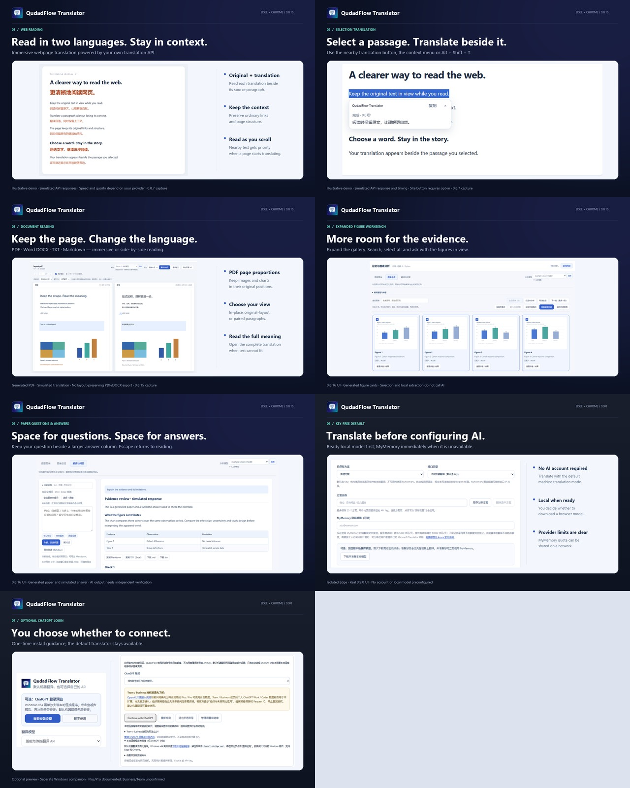

# QudadFlow Translator（Edge / Chrome 扩展）

**版本 0.9.0**：未配置 AI 时默认使用免 Key 机器翻译，先尝试已准备好的浏览器本地 Translator 模型，否则立即使用 MyMemory。首次下载本地模型需在设置中主动点击；默认翻译无需这一步。MyMemory 可能按共享网络计数，不能保证每位用户独立额度。限定并发与短期缓存改善响应，链接附近与竖排文本的译文位置更准确。已保存方案、接口选择、模型、连接测试和保存设置集中在同一个分区。
可选的 ChatGPT 计划官方登录为预览功能。Windows x64 用户须从 [v0.9.0 发布页](https://github.com/qudadd/qudadflow-translator/releases/tag/v0.9.0) 单独下载并安装本机连接程序；扩展更新无法代为安装。首次打开提供一次可关闭的引导，不改变默认机器翻译。OpenAI 开源接入目前只明确列出符合资格的 Plus／Pro，Business／Team 经此路径的资格尚未确认。一个个人 Pro 账号已读取 8 个真实模型并完成固定短句推理。详见 [安装与限制](docs/CHATGPT_LOGIN.md)、[更新说明](docs/RELEASE_NOTES_0.9.0.md)和[三平台状态](docs/STORE_SUBMISSION_0.9.0.md)。

**版本 0.8.16**：网页论文与 PDF/Word/TXT/Markdown 图表工作台新增 **展开工作台 / 返回阅读**，提供大图总览、集中的批量操作和问答结果分栏。切换布局保留选择、草稿及进行中的分析。见[更新说明](docs/RELEASE_NOTES_0.8.16.md)。

**0.8.15** 支持所有阅读界面自动读取上游模型，下拉框仅显示模型 ID；API 方案只在设置中新增和切换。PDF 可选逐页／连续阅读，增强按图注编号提取图表、可复制表格和总览内的 AI 候选核对流程，并收紧工作台占用。见[更新说明](docs/RELEASE_NOTES_0.8.15.md)和[三平台发布状态](docs/STORE_SUBMISSION_0.8.15.md)。

这是一个以沉浸式双语阅读和划词翻译为核心的 Manifest V3 扩展，面向 Microsoft Edge 和 Google Chrome。支持自备 Google、DeepL、Microsoft、OpenAI 兼容及自定义 JSON API，提供 PDF/Word/TXT/Markdown 原位及对照阅读、论文问答、图表提取、Skill、可选跨页记忆和 Python/R 草稿。Edge 已完成隔离环境集成验证，本轮 Chrome 集成尚未验证。当前三平台进度见[发布记录](docs/STORE_SUBMISSION_0.9.0.md)。

**QQ 交流群：1048123205**。在 QQ 中搜索群号加入，交流使用体验、反馈问题与功能建议。扩展弹窗和“设置 → 交流与支持”也可查看群号。0.7.1 同时新增上游模型读取、明确选型、草稿测试及此交流入口，见[更新说明](docs/RELEASE_NOTES_0.7.1.md)。

[](docs/STORE_PRESENTATION_0.9.0.md)

[新版商店展示资料](docs/STORE_PRESENTATION_0.9.0.md)包含中英文简介和七张带版本标注的截图，标明生成样例与模拟接口；真实翻译质量及速度取决于服务商。

GitHub、Edge 与 Chrome 的实际更新状态见[0.9.0 发布记录](docs/STORE_SUBMISSION_0.9.0.md)，商店提交与审核通过分别记录。

## 本次图表改进

显式捕获论文时，自动读取同源、带编号且符合条件的完整表格 HTML 链接，沿用原论文的站点会话，API 密钥不会发送给出版商。解析后将全部表格、图注和脚注加入本地复制、Markdown/TSV 导出与论文问答，无需调用 AI；失败保留原链接及重试。原文导航后绑定失效，重定向及验证页拒绝读取，不自动抓取普通引用、外站或补充材料。缩略图和原图重复版本合并，同编号的不同分图仍分别保留。

## 当前功能

- 保存最多 20 个具名 API 配置方案，包括接口、端点、Key、模型、请求头和语言；在设置的“API 方案与模型”分区中选择、编辑、“另存为新方案”、删除、测试和保存；所有阅读页仅切换当前 API 的模型。
- 默认免 Key 机器翻译：已准备好的浏览器本地模型可用时优先使用，其他情况立即使用 MyMemory；自动检测源语言。浏览器支持时，可在同一设置分区主动下载所选语言方向的本地模型。匿名额度为每天 5000 字符，用户自行填写有效联系邮箱后，服务商说明为每天 50000 字符；共享网络下不保证额度完全独立。本地翻译不消耗云端额度。
- MyMemory 免 Key 基础试用：默认英译简中，可手动更改源语言。

- 站点授权后，选中文字即可就近点击“翻译”，通过跟随选区的小浮窗查看结果、复制或重试；Esc 关闭。
- 保留扩展弹窗、右键菜单、`Alt+Shift+T` 快捷键划词入口。
- 翻译当前网页文本，并在页面右上角显示可复制的译文面板。
- 沉浸式翻译：译文紧随原段落，流式接口返回时逐步显示；优先翻译当前视区附近的段落，支持一键恢复原文。
- 沉浸式翻译默认可在已授权网页正文按 `Shift+A` 触发；设置中可自定义或停用，输入框和编辑器保留全选。右键菜单与 `Alt+Shift+I` 仍可使用。
- 设置 **阅读外观 → 沉浸式译文颜色** 提供色板、六位 HEX、浅深色预览及恢复默认；即时应用于网页和文档原位译文，不改变原文或页面比例。
- 直接机器翻译：Google Cloud Translation v2、DeepL API、Microsoft Translator。
- 配置 API 端点、API Key、模型、源/目标语言、温度、自定义请求头。
- OpenAI 兼容模式支持 Chat Completions、Responses 和流式接收；保留自定义 JSON 模式。
- 显示等待时长和进度；划词请求优先使用下一个空闲请求位置，整个页面最多两个并发请求。关闭划词卡片不会中断沉浸式任务。
- 相同文本与配置的成功译文可在五分钟内复用，避免再次调用 API；修改翻译配置后清空缓存，颜色与快捷键调整保留缓存，连接测试始终发出真实请求。
- 网站与 API 默认按域名授权；可在设置中主动选择“一次授权所有网站”，减少后续确认。
- 不加载远程脚本，不使用广告或遥测。

## 上游模型读取与明确选型（0.7.1）

设置页将保存方案、API 选择、模型、连接测试和保存设置归入“API 方案与模型”，另有阅读外观、论文记忆及交流支持导航，窄屏也可使用。OpenAI 兼容配置填写端点、Key 和必要请求头后，点击 **读取上游模型**；仅向端点同源的模型地址（通常为 `/v1/models`）发送鉴权信息，不附带网页正文。完整详情保留在设置标签页内存；最多 1000 个模型 ID、明确声明的输入输出类型、读取时间和连接摘要保存到本地，供其他页面的下拉框使用。最多缓存 20 个连接、合计 2 MB，超限淘汰最早列表；地址、Key 或请求头变化会隔离旧列表。已配置的 AI 连接首次打开阅读页且没有缓存列表时，会使用已保存的地址与鉴权自动读取，依赖现有 API 域名授权；未授权时提示到设置处理。各处均提供“刷新 / 取消”，同时打开多个页面共用一次请求。已有缓存不重复读取，失败或空列表保留当前模型；同一后台工作线程内不会自动反复重试，可手动刷新。页面传入的草稿连接不会被用于此读取。不设扩展倒计时，可随时取消。

读取列表不会自动选模型。弹窗、文档工具栏和论文／图表工作台共用当前模型选择；切换只改模型，不改 API 地址、密钥或请求头，同时停止正在进行的任务并同步其他窗口。当前保存方案也会记住该模型。上游未列出的现有手填模型继续保留；要使用新模型，应从该 API 已读取列表中选择，或在设置手动填写。传统 API 可继续正文翻译，使用 AI 图表功能需先在设置切换至支持图片的 AI API。

各设置分区均可独立收缩，支持 **收起全部 / 展开全部** 并在本机保留折叠状态；点击导航会展开对应区域，不改动已保存的 API 连接。

可搜索模型 ID，按上游实际返回的文本/图片能力筛选，查看上下文等元数据，再明确点击 **填入此模型**。不会默认选择第一项或覆盖现有模型。缺失能力标为“未知”，不凭模型名称推断读图、速度、价格或质量。上游没有模型接口时，可按其文档手动填写。

**测试连接** 使用当前未保存草稿发送固定短句，绕过缓存并显示耗时；不保存、不启用该草稿，也不验证图片能力。**停止测试** 可取消正在等待的调用；关闭或离开所属设置标签页也会取消其测试和模型读取。允许访问 API 域名的权限可保留。完成后点击 **保存设置** 才应用配置。连接更改后旧的模型读取和验证结果失效。

## 在 Edge / Chrome 中测试

1. 打开 `edge://extensions`（Edge）或 `chrome://extensions`（Chrome），开启“开发人员模式”。
2. 点击“加载解压缩的扩展”，选择本目录。
3. 打开扩展的“详细信息 → 扩展选项”。默认机器翻译无需填写 Key；使用其他提供方时，在“API 方案与模型”中选择并填写其必需参数。
4. 在同一分区点击“测试连接”并“保存设置”；按提示允许 API 域名权限。
5. 打开普通网页，点击扩展图标，再点击“沉浸式翻译当前网页”。
6. 需要便捷划词时，勾选“在此网站启用划词翻译按钮”，允许本站访问权限。随后选中文字，点击附近的“翻译”按钮即可；Esc 关闭。仅选择文字不会发送请求。

站点开关会保留到下次访问，权限按当前 HTTP/HTTPS 协议和主机匹配，包括该主机的所有端口。关闭开关会停用已加载页面中的按钮，并取消后续自动加载；如需撤销保留的站点权限，可在 Edge 扩展设置中操作。

在 **网站与 API 访问权限 → 一次授权所有网站** 中，浏览器确认后会持久允许 HTTP/HTTPS 网站、原图和 API 访问，减少后续确认。这也允许扩展读取这些网站，但不会自动启用所有站点的划词按钮。**恢复按站点授权** 会清除可选网站授权，包括此前单独授予的网站和 API 域名，之后按需重新授权。浏览器内置页、商店页仍受浏览器限制；本地文件 URL 访问需在扩展详情单独开启。

在未授权网站打开扩展弹窗时，仅显示紧凑的 **授权当前网站** 提示，详细说明默认折叠。点击按钮才触发浏览器确认，范围为该 HTTP(S) 主机的所有端口；拒绝或取消后保留重试。允许后立即隐藏，重开已授权网站不占空间；撤销后按实际权限重新显示。授权不发起翻译，也不自动开启划词按钮。浏览器内置页和商店不显示独立授权卡片。

扩展无法向 `edge://` 页面、内置 PDF 阅读器、Edge 加载项商店等保护页面注入网页翻译界面。浏览器打开的 PDF 可以通过扩展弹窗的“PDF / 文档左右对照”进入独立文档阅读器。

## PDF、Word 和文本沉浸式翻译

### 配置方案与快速试用

在设置页的“API 方案与模型 → 已保存方案”中选择历史方案，修改后点击同一区域底部的“保存设置”应用；“另存为新方案”会保留之前的方案。“测试连接”也在此区域内，测试未保存的当前草稿。打开设置时，原有已配置的连接会先保留到方案列表。删除正在使用的方案也会清空其当前连接密钥，其他方案中的 Key 不受影响。所有方案及密钥仅保存在此浏览器本地，不同步到 GitHub，也不记录翻译内容历史。

无需 Key 的体验入口是“启用 MyMemory 基础试用”，首次需允许其 API 域名。默认 English → 简体中文，其他语言需手动设置源语言。它提供翻译记忆匹配与机器翻译，匿名额度通常为每天 5000 字符；请求会按单段、500 UTF-8 字节拆分，段落标记在本地保留，成功的重复段落可在五分钟内复用，不调用公开贡献/上传接口，也不会在失败时暗中切换服务。文字通过 HTTPS 查询参数发送，服务商可能长期保留，请使用非私密短文试用。没有承诺完全不限量的免费公共 API。长文请使用自己的 API 或自托管兼容服务。详见 [MyMemory 额度](https://mymemory.translated.net/doc/usagelimits.php)和[条款/隐私说明](https://mymemory.translated.net/terms-and-conditions)。

### 文档阅读步骤

1. 在浏览器打开 PDF 后，点击扩展图标 → **PDF / 文档左右对照**，再打开预填的文档链接并允许来源域名。也可使用右键文档入口。登录下载或 blob 临时链接无法加载时，先下载文件，再点击 **打开文件** 或拖入阅读器。
2. 默认 **沉浸原位**：PDF 保持原页比例、图片和图表位置，在原文本区域显示译文。放不下或特殊排版的段落保留原文，点击 ↗ 查看完整译文。点击译文可查看对应原文，**查看原文** 可切换整页。
3. **原版左右对照** 同比例显示原页和译页；**段落对照** 重新排版文字，适合优先阅读内容。DOCX 保留浏览器渲染的页边距、表格、嵌入位图和段落位置；TXT、Markdown 固定阅读段落的位置，Markdown 按纯文本显示。
4. PDF 可在 **翻页方式** 选择 **逐页翻页 / 连续阅读**，选择保存在浏览器本地。连续模式自动更新当前页码、同步左右页内位置，只保留附近页面的画布；页码与箭头仍可跳页。
5. 正文使用当前已配置的传统机器翻译或 AI，选择目标语言后点击 **翻译当前页** 或 **翻译全文**。全文先处理当前页，后续页面按最新阅读位置排队；已发出的请求继续等待结果。支持流式显示、同步滚动、停止续译，每个阅读器最多两个并发请求。打开文件本身不发送翻译请求。
6. **导出双语 TXT** 保存正文原文和译文，未翻译部分明确标注。当前不导出保留版式的译后 PDF/DOCX。

### 紧凑图表工作台

提取图表、图表总览、解读与问答以及临时出现的候选核对共用一个区域。PDF 展开区固定在视口高度的 34% 内，可收起为单行；AI 页码设置与手动补图默认折叠。模型、任务状态与停止按钮统一展示，切换页签保留材料、选择和结果。

1. 在 API 设置中保存一个支持图片输入的 OpenAI 兼容配置。正文仍可使用 Google、DeepL、Microsoft、MyMemory 等传统接口。
2. 展开最下方 **图表工作台 → 提取图表**，优先点击顶部 **提取全文图表**，逐页扫描并显示进度，可随时停止；正文翻译等待 API 时也能提取或导入截图。**提取本页图表** 只检查当前页，首页为 0 不代表全文没有图表。PDF 按正式图表编号和图注关联位图、矢量图及跨页子图，过滤页眉、页脚和无可靠图注的图片；相邻页面中边框匹配的续表也会关联。文字表格按坐标重建，可直接复制／导出 Markdown、TSV 并参与论文问答。Word 仍可提取嵌入图片。遗漏内容可使用 **框选图表**、**提取整页** 或导入截图补充。先预览、核对范围，按需下载或移除；本地提取不调用 API。
3. 在 **图表模型** 中选择当前 API 支持图片输入的模型，在图表总览中批量选择后点击 **批量解读所选**，或在详情中点击 **翻译图文并解释**。此时才向所选 AI 发送图片、目标语言和分析指令。结果逐步显示，可停止、重试。

遗漏内容可在同一工作台展开 **图表总览 → AI 补充识别**，在上方选择当前 API 支持图片的模型，填写 `13-18` 或 `13,15,17` 等页码，留空仅识别当前页。点击 **识别并预览** 后，逐页向该端点发送页面图片（含正文）、该页提取文字及图片尺寸；不会自动调用 AI 兜底。校验并换算明确声明的比例、千分比、百分比、像素及角点坐标；推断的角点格式需手动勾选核对。坏候选单独记录，不丢弃有效项；某页 JSON 或坐标均不可用时，最多用同图发起一次格式纠正，仍失败则记录并继续下一页。API／HTTP 报错立即停止后续请求。展开结果报告查看原因，或点击 **重试问题页** 显式重跑受影响页面。成功候选在 **核对候选** 页签展示，即使后续页失败仍可核对，不使用遮罩弹窗；原文可继续滚动和翻页，点击 **查看原页** 对照。确认后才加入，不确定或替换裁剪默认不勾选；明确替换会清除该项旧解读与代码草稿。按页码、编号及区域重叠在普通和 AI 提取间共同去重。同表重复框、无名框及轻微偏移的复扫不会新增一张；重叠区域编号冲突需手动核对，更完整裁剪需明确替换。不同页的续表保留分段。定位请求附带当前页已有图表的编号和归一化坐标，帮助 AI 避免重复。确认或取消回到总览。停止会取消当前请求，配置或文档变化会关闭旧预览，换文档清空报告。图片表格加入后，可点击 **提取可复制表格** 进行待核对的 AI 转写。

图片最长边限制为 1600 像素，单张编码不超过 4 MB，最多载入 40 张/32 MB。文档图片存于当前标签页内存，不进入正文缓存；启用可选研究记忆时可保存分析文本；下载图片和导出 TXT 会保留在下载目录。AI 可能误读文字或数值，请核对原图。此工作流展示文字翻译和解释，不重绘图表，也不把扫描页自动变成原位译文。

图注与绘图定位采用启发式识别，无标签、扫描或复杂图表仍可能漏提取。PDF 文字表格会明确标为待核对：空单元格予以保留，行列、跨行跨列表头及脚注需与原页比对，不代表 OCR 或完整语义识别。新增关联明确 Figure legends 标题下的完整有序图注与后方数量一致的连续图版，数量、次序不明确则不猜测。46 页参考样例提取为 5 幅主图和 4 个 Table 1 页面分段；可复制表格排除斜向水印，避免续页重复表头。42 页样例的 Figure 1–4、Table 1–2 仍提取为 17 个页面分段（含十页 Table 1）；原 10 页样例仍提取出 4 幅图和 1 张 24 行（含表头）、6 列文字表格。本地提取均未调用 API。42 页样例文末按章节编号的无竖线补充表格仍需 AI 或手动补充；参考样例部分图版在原始 PDF 页边已被裁断，提取无法恢复页外不可见内容。私人 PDF、测试坐标及截图不放入仓库与安装包。AI 流程检查使用人工标注的模拟响应，不代表真实模型识别准确率。

文件最大 25 MB；PDF 和渲染后的 Word 保留 300 页资源限制。TXT/Markdown 阅读分段及提取正文不再按固定字符数截断。TXT/Markdown 支持 UTF-8 或带 BOM 的 UTF-16。Word 仅支持 DOCX；浏览器字体和复杂 Word 排版可能与 Microsoft Word 不同，严格保真请先另存 PDF。旧 DOC 请先转为 DOCX。扫描 PDF 的正文原位替换需先 OCR，当前无内置整页 OCR 替换；可将整页图片交给视觉 AI 阅读。复杂多栏、重叠文字、公式及特殊字体可能需段落模式或人工核对。

PDF.js、fflate、docx-preview 和 JSZip 随包提供，在浏览器本地解析文件，无远程可执行代码。正文翻译发送提取文字；主动点击 AI 定位会发送指定页面图片及文字，点击 AI 分析会发送所选裁剪，不上传原始 PDF/DOCX 文件或密码。远程文档下载需来源域名权限，可能携带该站点登录 Cookie。最低要求 Chromium 内核 Edge 125，集成测试使用 Edge 155。许可见 THIRD_PARTY_NOTICES.md。

已有侧载安装更新时，在原目录替换运行文件后，到 `edge://extensions` 点击扩展的“重新加载”，再刷新需要翻译的网页。浏览器中的 API 配置会保留。

## 论文问答、图表、Skill 与跨页面记忆（0.8.7）

在普通论文网页中，点击扩展弹窗的 **论文阅读与问答**，打开可移动、调整大小和展开的独立窗口，原文可阅读或编辑，HTML 表格转为 Markdown，图表保留图注和来源。规则识别 article、main、articleBody 等通用结构，不针对某篇示例或单一出版社。以后打开另一篇论文，或同一标签页切换到新论文，再点该入口即可提取新材料；旧窗口保留旧论文来源，跨页笔记记忆可单独选择。该操作为主动提取，不会后台抓取或自动同步旧窗口。

默认候选需有编号图注／引用、明确图表容器及图注，或图表语义；排除普通论文配图和自动整视区图，手动补图仍可用。懒加载与视区外图表会先列为候选，无需自动滚动或下载；可见 SVG/Canvas 可从临时视区截图中裁取。跨域图片通过 **载入原图** 授权来源域名后加载；**批量载入全部原图** 无需逐张选择，也不调用 AI。每次保留最多 100 个图表候选，并可在每份缓存合计 16 MB 内追加最多 12 张手动视区截图，窗口最多载入 40 张/32 MB。原生表格保留每张 10000 行、256 列、展开后 100000 单元格的资源上限，超限明确提示。补充附件标记为“未读取”，不会自动计入分析。通用识别仍可能遗漏无标签图表、复杂网页、嵌入框架或被保护的图片，请先核对材料，必要时使用 PDF 阅读器或手动框选。

HTML/ARIA 表格现在单独列为可展开的表格卡片；正文容器外的表格、跨行跨列表头、标题及脚注也会提取，并进入论文问答材料。全页扫描带图表语义的图片容器，减少正文外图表遗漏。论文窗口会把材料中提到的编号与已提取图注核对，区分未匹配图表、图片表格、部分表格和未读附件；0 张表本身不会触发 AI 或被判为失败。遇到疑似漏项，点击 **返回原文定位**，完整显示图表后在同一窗口 **补入当前视区截图**，核对预览后点击卡片 **用 AI 补读图表**。补读结果标为待核对，不覆盖原始表格，也不清除已有编辑、问题和回答。原论文关闭、刷新、跳转、截图中滚动或切换活动标签页时会拒绝补图，避免串页。也可在研究窗口 **导入图表截图** 或在“提取图表 → 手动补图”中点击粘贴区域后按 Ctrl+V 粘贴截图。PDF、Word、TXT、Markdown 阅读器共用截图导入功能。支持 PNG/JPEG/WebP，单文件最多 10 MB、3200 万像素，预览最长边缩至 1600 像素。图片仅本地载入、不自动勾选；核对后再点击分析或勾选后提问。支持视觉输入的 AI 会被要求按行列转写图片表格，保留单位、数值及脚注，标注无法读清或被裁去的部分；结果仍需对照原图核验，无法保证所有网站都能自动提取。

PDF、DOCX、TXT、Markdown 在阅读器底部展开 **图表工作台 → 解读与问答**，共用 Skill、笔记本、问题和导出入口。可选当前页或全文，移除原来的 6 万字论文限制，完整提取正文不按固定字数截断。上游模型上下文、接口请求大小和浏览器内存限制仍然适用；服务商拒绝请求时显示报错，不静默删除论文后半部分。

在 **图表总览** 点击 **全选图表（数量）**，一次选中全部可用图表，包括搜索范围外及原图待载入项目；**取消全选** 清除全部勾选。全选本身不下载原图或调用 AI。也可搜索图号、图注或页码，搜索时显示 **选中筛选结果**，仍支持 **仅选未分析**。总览与详情的勾选同步；筛选外的已选数量会明确显示。**批量载入全部原图** 无需选择即可加载待载入项；搜索后变为 **载入筛选结果原图**。**载入所选原图** 只处理勾选项。每批合并请求来源权限、显示下载进度并支持失败重试，不调用 AI。**批量解读所选** 逐张分析已选原图，可随时停止并保留结果。**下一组（最多 4 张）** 按当前筛选切换已载入图片，**结合所选提问** 定位输入框并保留已有问题，点击发送后才调用 AI。问答输入框旁新增 **全选图表并提问**，总览也有 **全选并提问**：包含筛选外项目，并在同一次点击中按需授权、载入待加载原图；保留已有问题，点击发送后才调用 AI。最多 4 张且合计不超过 12 MB 时直接结合原图提问；更多图表则先逐张读取，再把全部带编号、来源的 AI 笔记与所选正文综合回答，N 张共 N+1 次请求，发送前明确显示。汇总请求接收 AI 笔记而非原图，笔记仍需核查。逐图步骤不使用或保存跨页面记忆，最终回答遵循所选 Skill 与记忆开关。停止或接口报错会结束后续读图及汇总，完成的逐图结果保留。未载入项会阻止发送并保留已有问答。原生文字表格无需勾选，支持一键展开／收起全部预览。不选图片时可用纯文本模型。结果按标题、列表、表格和代码排版，支持追问、Ctrl/Cmd+Enter 发送、新对话及 Markdown 导出。当前窗口最多保留 20 轮，请求附带最近最多 6 轮完整回答/2.4 万字；未完成的回答可导出，但不参与后续上下文。单独图表分析附带图注及提取页最多 8000 字上下文，翻页后仍保留原提取页来源。

图片表格会从相邻说明、可访问性标签及精确页内引用保留 Table / Figure / 图 / 表编号；缩略图与图注组成的排版表不再误算成数据表。**选中图片表格** 一次选中这些候选，不下载、不调用 AI。通过原图链接、放大属性或更大的 srcset 读取页面提供的高清来源；有效位图即使缺少或使用通用 MIME 也会经过签名检查和解码验证。原图转为 JPEG，最长边最多 3200 像素、不放大；截图和导入仍为 1600 像素。仅脚本可打开的放大图、需登录或无法访问的图片仍可能需要手动导入。

每张识别出的文字表格及 AI 返回的 Markdown 表格都有 **复制 Markdown**、**复制 TSV（Excel）**、**下载 .md**、**下载 .tsv**。网页和 Word 文字表格无需 AI；TXT / Markdown 会在全篇提取管道表格。合并单元格展开为重复值，Markdown 带标题、脚注和截断提示；保留数字字符串、符号、竖线及单元格换行。TSV 将类似公式的内容作为文字处理，但 Excel 等软件仍可能自动格式化数字。剪贴板失败时提供选中的只读文本供手动复制。图片表格按 **选中图片表格 → 载入所选原图 → 转写所选表格** 批量操作；单图、导入截图及 PDF 整页或框选区域也可点击 **提取可复制表格**。这一步明确调用视觉 AI，标记读不清或缺失的单元格，结果标为未经核验；未返回表格时如实提示，不从曲线编造精确数值。

内置论文精读、方法/统计审查、图表解读三种 Skill。在设置页可复制、编辑、导入或导出 JSON/Markdown/TXT；最多 20 个自定义模板，每个 4000 字。这是纯文本分析指令模板，不运行脚本。

跨页记忆默认关闭。主动开启后按研究笔记本隔离，仅向所选 AI 附加该笔记本的相关记录并保存新分析，不影响基础翻译。最多 20 个笔记本；每次最多 6 条和 4000/6000/12000 字（默认 6000）。IndexedDB 分条保存并去重，总计最多 300 条、200 万内容字符，超限淘汰最早记录。单条最多 2000 字原文摘录和 10000 字分析，带来源标题、去除查询参数/片段的 URL 和页码。保留期限可选 7/30/90 天（默认 90）或仅容量限制，到期后在后续研究操作清理。关闭记忆停止后续使用/保存，旧记录需删除或等待到期；设置支持搜索、删除、清空和全部导出 JSON/Markdown。导出不含 API 配置、密钥或图片，但含已保存研究文本。

图表识别完成后，点击 **生成 Python** 或 **生成 R**，下载 .py/.R 草稿及说明。提示要求引用原数据或读取用户提供的 data.csv，标明图中估读值，不用虚构样本替代证据。扩展不执行生成代码；需自行核对代码、依赖、数据和方法，单张图片不能保证精确科学复现。

网页提取材料有独立本地临时缓存：最多 4 份、每份图片字节不超过 16 MB，1 小时到期后在后续研究操作清理，不属于跨页记忆；本地文档图片仍在标签页内存。分析请求会发送所选文字/图片、来源、Skill、问题和已启用的相关记忆。详见[隐私政策](https://qudadd.github.io/qudadflow-translator/privacy.zh-CN.html)。

## API 配置示例

### Google Cloud Translation v2

```text
接口类型：Google Cloud Translation v2（机器翻译）
端点：https://translation.googleapis.com/language/translate/v2
API Key：Google Cloud API Key（启用 Cloud Translation API）
```

扩展会把 Key 作为 `key` 参数发送，并从 `data.translations[0].translatedText` 读取结果。

### DeepL API

```text
接口类型：DeepL API（机器翻译）
端点：https://api-free.deepl.com/v2/translate
API Key：DeepL API Key
```

免费版使用 `api-free.deepl.com`，专业版通常使用 `api.deepl.com`。扩展使用 `Authorization: DeepL-Auth-Key ...` 请求头和 `translations[0].text` 响应路径。

### Microsoft Translator

```text
接口类型：Microsoft Translator（Azure 机器翻译）
端点：https://api.cognitive.microsofttranslator.com/translate
API Key：Azure Translator Key
Azure 区域：例如 eastus（多区域资源可能需要）
```

### OpenAI 兼容接口

```text
端点：https://api.openai.com/v1/chat/completions
模型：gpt-4o-mini
```

DeepSeek、Moonshot、智谱、通义、硅基流动等服务通常可以填写其 OpenAI 兼容端点和模型名。具体地址、模型名和鉴权方式以服务商文档为准。

如果服务商要求 Responses 协议，请填写完整的 `https://你的服务商域名/v1/responses`。只填写域名或 `/v1` 时，扩展默认使用 Chat Completions，不会自动切换协议。

默认启用流式接收；网关不支持时可以在设置中关闭。Temperature 可留空，使用上游默认值。基础翻译、模型读取、连接测试、论文／图表／代码分析均不设扩展倒计时；实际 HTTP、网络或流错误会停止请求，也可手动停止。HTTP 错误立即报告，不等待错误正文或自动重试被拒绝的参数；旧版超时偏好不再生效。上游服务和浏览器网络机制仍可能中断请求。图片和文档下载继续保留资源保护。待发翻译在空闲槽位重新按当前视区排序，滚动不取消正在等待的请求；长段落分块之间让出位置，新增可见文字可使用空闲槽位。模型反复破坏段落标记时会停止额外重试，避免大量逐段调用。真实速度仍取决于你使用的模型和网关。

自定义 JSON 示例：

```json
{
  "model": {{model}},
  "prompt": {{text}},
  "source": {{sourceLanguage}},
  "target": {{targetLanguage}}
}
```

响应路径可以填写 `data.translation`、`result` 或 `choices[0].message.content`。模板占位符必须作为 JSON 值使用，扩展会负责 JSON 转义。

## 打包

在 PowerShell 中运行：

```powershell
.\package.ps1
```

打包脚本用同一文件清单执行复制、依赖检查及 ZIP 审计：检查 Manifest、图标、自有脚本语法和本地依赖，再验证暂存运行目录，逐个比对压缩包文件与源文件字节。通过后生成 `outputs/qudadflow-translator-v0.9.0.zip`、独立源码包、审计 JSON 和 `SHA256SUMS-v0.9.0.txt`；源文件校验失败时保留已有安装包。固定 ZIP 时间戳和路径顺序，使相同源码在同一 Node/PowerShell/.NET 环境中构建结果一致。运行包不含开发测试、截图与文档；打包不会自动发布。可以用 `-OutputDirectory` 指定输出目录。文档库已放入 `vendor/`，不需额外安装依赖；`tools/vendor-document-libs.mjs` 可按固定版本与 SHA512 校验重新下载这些依赖。

## 项目与上架信息

- GitHub 仓库：https://github.com/qudadd/qudadflow-translator
- 项目网站：https://qudadd.github.io/qudadflow-translator/
- 中文使用指南：https://qudadd.github.io/qudadflow-translator/zh-CN.html
- 英文隐私政策：https://qudadd.github.io/qudadflow-translator/privacy.html
- 中文隐私政策：https://qudadd.github.io/qudadflow-translator/privacy.zh-CN.html
- 支持邮箱：lcf1249288484@outlook.com；商店截图位于 `branding/screenshots`。
- QQ 交流群：**1048123205**（在 QQ 中搜索群号加入）。
- 按目标 API 服务商的条款确认用户文本和 Key 的处理方式。
- 使用真实 API 在干净的 Edge 配置中完成侧载验收，再提交商店审核。

三个平台实际进度见[0.9.0 发布记录](docs/STORE_SUBMISSION_0.9.0.md)；中英文商店简介和截图见[展示资料](docs/STORE_PRESENTATION_0.9.0.md)。

## 自动功能验证

安装 Playwright（不需要下载额外浏览器），使用本机 Edge：

```powershell
npm install --no-save playwright
node tools/functional-check.cjs functional-results.json
node tools/document-check.cjs document-results.json
node tools/configuration-check.cjs configuration-results.json
node tools/layout-check.cjs layout-results.json
node tools/research-check.cjs research-results.json
node tools/model-check.cjs model-results.json
node tools/research-companion-check.cjs companion-results.json
node tools/research-vision-check.cjs vision-results.json
node tools/research-coverage-check.mjs coverage-results.json
node tools/build-check.mjs build-results.json
```

0.8.7 本轮已通过 **342 项检查，0 失败：331 项行为检查及 11 项构建／打包检查**。行为检查覆盖 11 套隔离 Edge 检查，包括快捷键手动/录制/取消、颜色不重译、全选、视区优先、模型列表、文档、编号图注与原图、AI 补图、表格导出、记忆及引用核对。使用虚构凭据、生成文档、已保存公开网页与本地模拟 API；真实模型速度、准确率及本轮 Chrome 集成尚未经验证。结果与 ZIP 字节审计见[验证记录](docs/VERIFICATION.md)，完整功能见[0.8.7 更新说明](docs/RELEASE_NOTES_0.8.8.md)。

此前 0.8.1 已通过 **240 项检查，0 失败**：八组 Edge 检查共 229 项，构建检查 11 项；本轮没有重复所有旧版检查。包含 Ovid 公开论文的 4 张独立图和 4 张独立表卡。问答浮窗脚本默认测试通用模拟论文；第二个参数可传入已保存的公开 Ovid HTML，加入该项检查。构建测试使用临时源码副本及故意损坏的安装包；浏览器测试使用生成文档、虚构 Key、本地模拟接口及独立 Edge 配置，不读取真实用户 API 设置。检查结果不能代表真实服务商速度、额度、可用性或翻译质量。此前独立 Chrome 检查未能加载扩展服务工作线程，不能据此宣称已在 Chrome 验证通过。具体结果见 [验证记录](docs/VERIFICATION.md)。

网页面板每次最多翻译 12000 个字符并显示截断提示。沉浸式模式扫描页面正文、开放 Shadow DOM 和可访问的同源框架，包含短标签，不按固定段落数或正文字数截断。扫描定期让出执行时间，长段落拆分、批量请求、最多两个并发，优先当前视区。本地语言识别跳过确认已是目标语言的文字，对中日混合内容保守判断。开启后滚动、展开、插入或修改文字会补译；关闭浮窗、恢复原文、修改配置或跳转页面时停止。恢复保留原始文字节点和链接身份。编辑区域、不可见内容和 translate=no 内容不会自动提取；封闭 Shadow DOM、无权访问的框架和图片中文字仍可能需要手动处理。双语文字会增加段落高度，固定高度等特殊布局仍可能需要适配。

双语阅读会增加段落高度。固定高度、虚拟滚动、内嵌框架、Shadow DOM 等复杂页面仍可能需要专门适配；本版本没有承诺所有网站都保持原高度或布局完全不变。

缓存仅位于服务工作线程内存中，最多 128 条、合计 250000 个字符，复用有效期五分钟；更改配置、缓存淘汰或工作线程退出时移除。不会写入磁盘翻译历史，浏览器可随时结束空闲工作线程，所以缓存不保证保持完整五分钟。连接测试绕过缓存。
