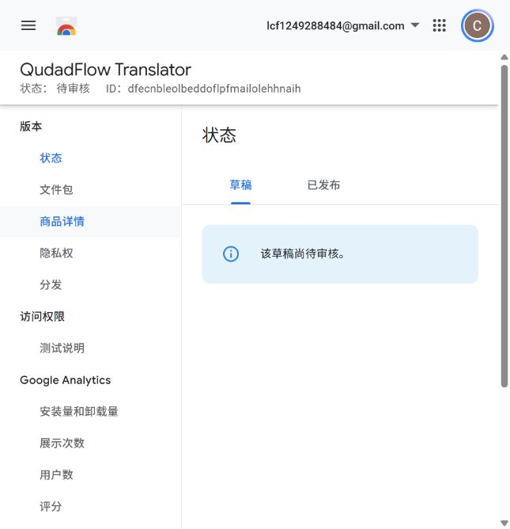

# Chrome Web Store submission — QudadFlow Translator 0.7.1

Status confirmed on October 21, 2026, 15:57 China Standard Time (07:57 UTC): **0.7.1 submitted to Chrome Web Store; Pending review; automatic publication selected for approval.** The dashboard displayed “已将您的扩展程序提交送审” (extension submitted for review), then “待审核” and “该草稿尚待审核” on the status page. The package page reported version 0.7.1, both English and Chinese locales, and activeTab/contextMenus/scripting/storage permissions. This is a successful review submission, not confirmation of approval or public availability.

- Publisher ID: `40a6be45-5eb1-405c-81c6-ebd93724eb16`.
- Item ID: `dfecnbleolbeddoflpfmailolehhnaih`.
- [Dashboard](https://chrome.google.com/webstore/devconsole/40a6be45-5eb1-405c-81c6-ebd93724eb16/dfecnbleolbeddoflpfmailolehhnaih/edit).
- English description (3,872 characters) and Chinese description (1,503 characters) saved, with the product name unchanged. The text comes from [STORE_PRESENTATION_0.7.1.md](STORE_PRESENTATION_0.7.1.md), replacing the Edge minimum-version wording with Chrome/Chromium 125+.
- Store icon and five global screenshots saved. Category: **Tools**, under Productivity. Homepage and support URLs saved.
- Single-purpose and all four permission explanations saved; remote code declared **No**. Authentication information, web history/source metadata, and website content disclosed. All three limited-use certifications and the English privacy-policy URL saved.
- Distribution currently shows **Free**, **Public**, and **All regions**.
- A 400-character reviewer note saved, describing the optional MyMemory trial and linking to the full reviewer guide. No private credentials supplied.

The account holder completed verification of **lcf1249288484@outlook.com**. Reloading publisher settings confirmed it as a verified email, and the Submit for review action became available. The final confirmation retained “Automatically publish after review” as checked. The submission completed successfully. **Approval and public availability remain pending Google's review.**

## Upload package and assets

- Runtime: qudadflow-translator-v0.7.1.zip. Use this ZIP, not the separate source ZIP; manifest.json is at its root.
- Title: **QudadFlow Translator** (keep the same English title in every language).
- English summary (under 132 characters): **Immersive webpage and document translation with your own API, selection translation, and optional paper and figure analysis.**
- Saved category: Tools, under Productivity. Interface language: Simplified Chinese; English and Simplified Chinese listings.
- Saved store icon: assets/icon128.png. Five global screenshots from branding/store-0.7.1/: immersive, selection, documents, figures-code, and model-settings. Chrome permits at most five; the separate paper-analysis image was omitted. Simulated-translation screenshots are labeled examples and do not demonstrate live-provider quality.
- Homepage: https://qudadd.github.io/qudadflow-translator/
- Support: https://github.com/qudadd/qudadflow-translator/issues
- Support email: lcf1249288484@outlook.com
- Privacy: https://qudadd.github.io/qudadflow-translator/privacy.html
- Chinese privacy: https://qudadd.github.io/qudadflow-translator/privacy.zh-CN.html
- Community: QQ 1048123205; search the number in QQ.

## Earlier prepared English copy (submitted text linked above)

QudadFlow Translator helps you read webpages and documents in another language using your own translation provider.

• Immersive bilingual webpages, with streamed translation beneath the original paragraph, nearby text priority, and restore-original control.
• Selection translation: enable the site button, select text and click Translate; selecting text alone sends nothing.
• PDF, Word DOCX, TXT and Markdown: in-place reading, original-layout comparison and paired paragraphs. PDF preserves page proportions, images and charts. Text that does not fit retains its original with a full-translation link. Word uses browser rendering and can differ from Microsoft Word.
• Choose Google Cloud Translation, DeepL, Microsoft Translator, OpenAI-compatible Chat Completions/Responses, custom JSON, or an optional quota-limited MyMemory basic trial. Traditional MT and AI both support basic translation.
• Save up to 20 API configurations. Read an OpenAI-compatible upstream model list, search IDs, inspect capabilities only when reported by the provider and explicitly choose a model. Missing data stays unknown. Test the current draft before saving; a short text test does not verify vision support.
• Optional paper tools extract article text, captions and figures locally. Use built-in or custom text Skills to analyze the same reading material, then export Markdown. Figure interpretation requires an image-capable AI model.
• Optional cross-page research memory is off by default. Notebook records are local, bounded, searchable, deletable and exportable. Basic translation does not use research memory.
• After chart recognition, download Python/R drafts and data-requirement notes. Generated code is never executed. Exact reproduction requires original data and independent checks.

Requests start with your action and go directly to the API you configure. No developer proxy, ads, analytics or remote executable code. Files are parsed locally; original PDF/DOCX bytes and passwords are not uploaded to translation APIs. Clicking analysis can send selected images, text, source metadata, Skills and enabled related memory. Model discovery sends credentials to the same-origin models route, without page text. API keys are stored locally in the browser.

Provider accounts, fees, quotas and retention terms apply. The MyMemory trial is not unlimited and may retain submitted text; use non-private short samples. Limits: 25 MB/document, 300 pages/sections, one million extracted characters; paper input up to 60,000 characters. Scanned-body replacement needs external OCR. Export does not create a layout-preserving PDF/DOCX. Interface: Simplified Chinese. Manifest requires Chromium 125+.

QQ community: 1048123205 (search in QQ)
Support: lcf1249288484@outlook.com
Privacy: https://qudadd.github.io/qudadflow-translator/privacy.html

## 中文说明（可选本地化）

名称保持 QudadFlow Translator。已保存的中文详细说明使用 [0.7.1 展示文案的 Chinese description](STORE_PRESENTATION_0.7.1.md)，运行要求改为 Chrome/Chromium 125+。Edge 审核状态不代表 Chrome 上架状态。

## Privacy practices and permission explanations

Single purpose: translate user-selected webpages and documents with a user-chosen API, with optional research tools that explain the same reading material.

Data-use disclosure should include authentication information (API keys/custom authentication), website content (chosen text, document excerpts/images and research results), and web history/source information (the explicitly captured source origin/path/title, not automatic history collection). Processing can be local or direct to the user-chosen provider as described in the policy. Do not select “no user data” merely because the developer operates no server. No data is sold or used for advertising, unrelated purposes, creditworthiness or lending.

| Permission / capability | Purpose |
| --- | --- |
| activeTab | Read the active page/selection and capture an explicitly requested visible figure after an extension action. |
| scripting | Inject bundled translation/selection UI on the active page, or on a site explicitly enabled by the user. |
| contextMenus | Provide user-initiated translation/document/paper commands. |
| storage | Keep API configurations, preferences and prompt templates locally; bounded research/capture data uses local IndexedDB. |
| Optional HTTP(S) hosts | Call the user-configured API, read its model list, download a chosen remote document/image, and enable selection UI only on a requested site. Arbitrary user-selected providers and document hosts cannot be enumerated in advance. No mandatory all-host permission. |
| Bundled WASM | Local PDF decoding/rendering. CSP permits bundled WebAssembly; no remote parser/code download. |

Remote code: **No**. All executable JS/WASM is in the ZIP. Provider responses, Skills and Python/R drafts are text data, never evaluated/executed. No remote CDN scripts, dynamic downloaded code or developer relay.

Reviewer instructions: [CERTIFICATION_NOTES_0.7.1.txt](CERTIFICATION_NOTES_0.7.1.txt). Do not include a private provider key in the listing, reviewer note or package. Provide the published privacy URL and verify the dashboard's current declarations against the actual extension.

## Validation and remaining submission steps

191 Edge integration checks passed. An installed-Chrome test stopped before integration because the extension service worker did not load; only two pure logic checks passed. This does not verify Chrome operation or official certification. Before review, install the runtime using Chrome's Load unpacked UI and verify settings/model list, a normal webpage and a generated document with a test endpoint.

Next: await Google's review result. Automatic publication was selected, so an approved item should publish through the normal store flow; confirm availability before describing it as live or distributing a public store installation link. Do not cancel the pending submission just to re-upload the same package. Never pay a registration fee or accept a legal agreement on behalf of the account holder without the required user action/confirmation.
