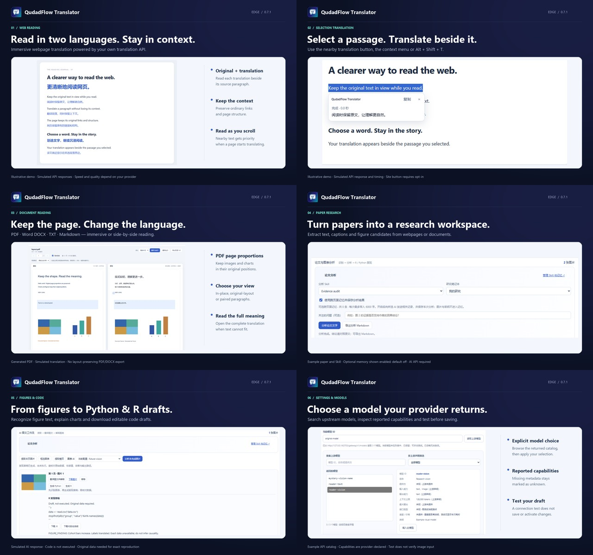

# QudadFlow Translator — storefront presentation refresh

This is a listing-only refresh for the existing 0.7.1 package. The runtime ZIP,
source release ZIP, manifest, name and permissions are unchanged.

On 21 October 2026, both language listings were saved in Partner Center with
these descriptions and six screenshots each. Publishing was blocked because
0.7.1 is already in review. These are saved draft materials, not a confirmed
live storefront update. See the [update record](STORE_PRESENTATION_UPDATE_0.7.1.md).

## English description

Read webpages in two languages, translate selected text beside the passage, and read documents with your own translation API. QudadFlow Translator combines immersive translation with optional AI tools for papers and figures.

IMMERSIVE WEBPAGE & SELECTION TRANSLATION
Keep the original paragraph and its translation together while you read. Ordinary links and page structure remain available. Translate a selected passage with a nearby button, the right-click menu or Alt+Shift+T. Enable the selection button for each site you choose; selecting text alone does not send it to an API. Browser-internal pages and restricted store pages cannot be translated.

YOUR API, YOUR MODEL
Use Google Cloud Translation, DeepL, Microsoft Translator, an OpenAI-compatible Chat Completions/Responses service or a custom JSON API. Traditional machine translation and AI both support the core reading features. Save and switch API configurations. An optional MyMemory trial is available for short, non-private text, subject to its daily quota and retention terms.

Redesigned Settings can read your upstream model list, search returned models and show capabilities supplied by your provider. Choose a model explicitly; missing capabilities stay unknown. Test the current connection draft before saving. The connection test does not save changes or verify image input. Some services do not expose a model list, so manual model IDs remain supported.

PDF, WORD, TXT & MARKDOWN
Open local files or supported document links in the extension reader. Choose in-place immersive translation, original-layout side-by-side comparison or paired paragraphs. PDF retains its page proportions, images and chart positions. If translated text cannot fit, the reader keeps the original and lets you open the full translation. Translate one page or the document, stop/resume, and export bilingual TXT. Word layouts and fonts can differ from Microsoft Word.

OPTIONAL PAPER & FIGURE WORKSPACE
Extract article text, captions and figure candidates from paper webpages; documents share the same analysis tools. Review the material, choose a close-reading, methods/statistics or figure Skill, and ask your own question. Edit or import custom prompt templates and export analysis as Markdown.

With a compatible vision AI model, translate text in extracted images and request chart explanations. After figure recognition, download Python or R reproduction drafts and data-requirement notes. Generated code is never executed by the extension; check its methods and values, and supply original data where required. A figure image cannot guarantee exact scientific reproduction.

Optional cross-page research memory is off by default. Enable a notebook to reuse related analysis across pages. Records stay in bounded local storage, separated by notebook, with retention controls, search, deletion and JSON/Markdown export. Ordinary translation does not use research memory.

DATA & REQUIREMENTS
Document parsing and extraction happen locally. User-triggered translation sends extracted text directly to your configured service; optional AI analysis sends chosen materials, source information, Skills and enabled related context. API configurations and keys stay in browser-local storage. No developer proxy, ads, analytics or remote executable code. Your provider's fees, quotas and retention terms apply.

Limits: 25 MB/document, 300 pages/reading sections and one million extracted characters; paper analysis up to 60,000 characters; up to 20 images/24 MB with bounded resolution. Scanned body replacement needs external OCR. Export does not create layout-preserving PDF/DOCX files. The interface is in Simplified Chinese. Requires Chromium-based Edge 125+.

QQ community: 1048123205 (search the group number in QQ)
Support: lcf1249288484@outlook.com
Privacy: https://qudadd.github.io/qudadflow-translator/privacy.html

## Chinese description

边读原文，边看译文；划选文字，就近查看翻译。QudadFlow Translator 将网页沉浸式翻译、划词翻译与文档阅读结合起来，支持自带翻译 API，并提供可选的 AI 论文与图表分析工具。

【网页沉浸式与划词翻译】
原文与译文按段呈现，保留普通链接及网页结构，方便连续阅读。划选文字后，可使用就近翻译按钮、右键菜单或 Alt+Shift+T 查看结果。划词按钮按网站主动开启，仅选中文字不会发送翻译请求。浏览器内部页面及受限的扩展商店页面无法注入翻译界面。

【自选接口，明确选择模型】
支持 Google Cloud Translation、DeepL、Microsoft Translator、OpenAI 兼容 Chat Completions/Responses 以及自定义 JSON API。传统机器翻译与 AI 均可完成基础阅读翻译；可保存并切换多套 API 配置。另提供 MyMemory 有限试用，适合短篇、非隐私文本，受服务商每日额度和数据保留条款限制。

新版设置支持读取上游模型列表、搜索模型并查看服务商返回的能力信息，由你明确选择后填入。未返回的能力显示未知，不根据名称猜测。可先测试当前配置草稿，再保存启用；连接测试不保存更改，也不验证图片输入能力。未提供模型列表的接口仍可手动填写准确模型 ID。

【PDF、Word、TXT、Markdown 文档阅读】
从本地文件或支持的文档链接打开阅读器，选择沉浸原位、原版左右对照或段落对照。PDF 保持原页比例及图片、图表位置；译文放不下时保留原文，点击查看完整翻译。支持当前页或全文翻译、停止续译及双语 TXT 导出。Word 的浏览器排版和字体可能与 Microsoft Word 有差异。

【可选 AI 论文与图表工作台】
从论文网页提取正文、图注和图表候选，并与文档阅读器共用论文分析。先检查材料，再选择论文精读、方法/统计审查或图表解读 Skill，加入自己的问题。支持编辑、导入自定义提示词模板及 Markdown 分析导出。

使用支持图片输入的 AI 模型，可翻译提取图片中的文字并解释图表。图表识别后，可下载 Python/R 复现草稿和数据要求说明。扩展不执行生成代码；代码、方法和估读数值需要核对，必要时需补充原始数据，单凭图片不能保证精确科学复现。

跨页研究记忆默认关闭。主动开启笔记本后，可在不同页面间复用相关分析；记录按笔记本隔离，保存在有容量及保留期限限制的本地存储中，支持搜索、删除和 JSON/Markdown 导出。基础翻译不使用研究记忆。

【数据与使用要求】
文档解析和提取在本地完成。主动翻译时，提取文字直接发送至所选接口；可选 AI 分析会发送选定材料、来源信息、Skill 和已启用的相关上下文。API 配置和 Key 保存在浏览器本地。无开发者中转代理、广告、遥测或远程可执行代码；费用、额度和数据保留规则由所选服务商决定。

限制：每文档 25 MB、300 页/分段、100 万提取字符；单次论文分析最多 6 万字符；图片最多 20 张/24 MB，分辨率受限。扫描正文替换需先进行外部 OCR；不导出版式保真的 PDF/DOCX 文件。界面为简体中文，最低要求 Edge Chromium 125。

QQ 交流群：1048123205（在 QQ 搜索群号加入）
支持邮箱：lcf1249288484@outlook.com
隐私政策：https://qudadd.github.io/qudadflow-translator/privacy.zh-CN.html

## Screenshots

Six English-titled 1280 × 800 PNG images are in `branding/store-0.7.1/`.
They show actual extension UI with generated demo documents, synthetic API
responses and an example model catalog. They do not demonstrate live provider
quality or speed. Research capture controls are unchanged from 0.7.0.
`media.json` records the source crops, captions, dimensions and SHA-256 hashes.
Rebuild using `python tools/build-store-presentation.py` with Pillow installed.

1. [Immersive bilingual reading](../branding/store-0.7.1/qudadflow-01-immersive.png).
2. [Nearby selection translation](../branding/store-0.7.1/qudadflow-02-selection.png).
3. [PDF immersive/original-layout comparison](../branding/store-0.7.1/qudadflow-03-documents.png), with supported document formats.
4. [Paper analysis, Skills and optional notebook memory](../branding/store-0.7.1/qudadflow-04-paper-analysis.png) (shown enabled, default off).
5. [Figure analysis and Python/R drafts](../branding/store-0.7.1/qudadflow-05-figures-code.png); generated code is not executed.
6. [New settings and upstream model discovery](../branding/store-0.7.1/qudadflow-06-model-settings.png); metadata is provider-declared.

English and Chinese captions are stored separately in `media.json`.
