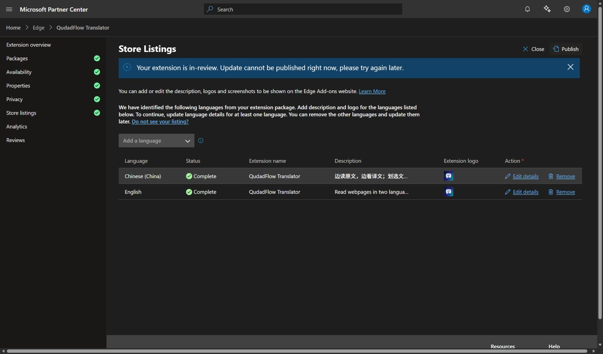

# Store presentation update — 0.7.1

Recorded on 21 October 2026, 14:43 China Standard Time (06:43 UTC).

## Result

Updated English and Chinese (China) descriptions and six screenshots per
language were saved in Microsoft Edge Add-ons Partner Center. Both language
rows show **Complete**. Reopening the language editors confirmed the saved
images and captions. English image headlines are shared; screenshot captions
are localized for each listing. The name remains **QudadFlow Translator**.

The Publish action returned:

> Your extension is in-review. Update cannot be published right now, please try again later.

The presentation refresh is therefore **saved as a draft, with publication
blocked by the existing review**. It was not accepted as a new submission and
must not be described as live. The existing 0.7.1 review was not cancelled.
Retry the ordinary Publish flow once Partner Center permits another update.
The current certification notes are in
[`CERTIFICATION_NOTES_SUBMITTED_0.7.1.txt`](CERTIFICATION_NOTES_SUBMITTED_0.7.1.txt).

## Materials

- [English and Chinese descriptions, screenshot links](STORE_PRESENTATION_0.7.1.md).
- [Six-image preview](../branding/store-0.7.1/preview.jpg).
- [Captions, source crops and SHA-256 hashes](../branding/store-0.7.1/media.json).
- [Repeatable image compositor](../tools/build-store-presentation.py).
- [Saved Chinese screenshot gallery](store-presentation-screenshots-zh-v0.7.1.jpg).

The six screenshots cover immersive webpage reading, selection translation,
document reading, paper analysis and Skills, figure analysis and Python/R
drafts, and upstream model discovery in Settings. They use real extension
captures with generated documents, synthetic API responses and example model
metadata. Labels disclose the demonstrations; no live-provider latency or
quality claim is made. Research controls captured in 0.7.0 are unchanged in
0.7.1. QQ community 1048123205, the support address and privacy links appear in
both descriptions.

## Validation and scope

All six PNG images are 1280 × 800. Their image and source hashes match
`media.json`; image decoding and visual review passed. Partner Center accepted
the images and both descriptions. `git diff --check` passed.

This change only adds presentation assets, documentation and README previews.
The extension manifest, permissions, runtime source and existing release ZIPs
were not changed. No new functional-test result is claimed for this listing
refresh; 0.7.1 validation remains documented in the existing release records.

Product ID: `9f4adbe4-d6a4-47d4-a038-f832abc37c84`.

[Public Edge listing](https://microsoftedge.microsoft.com/addons/detail/nichpjndbjbcfkcbanfcfogpkdhblghh)
· [GitHub repository](https://github.com/qudadd/qudadflow-translator)
