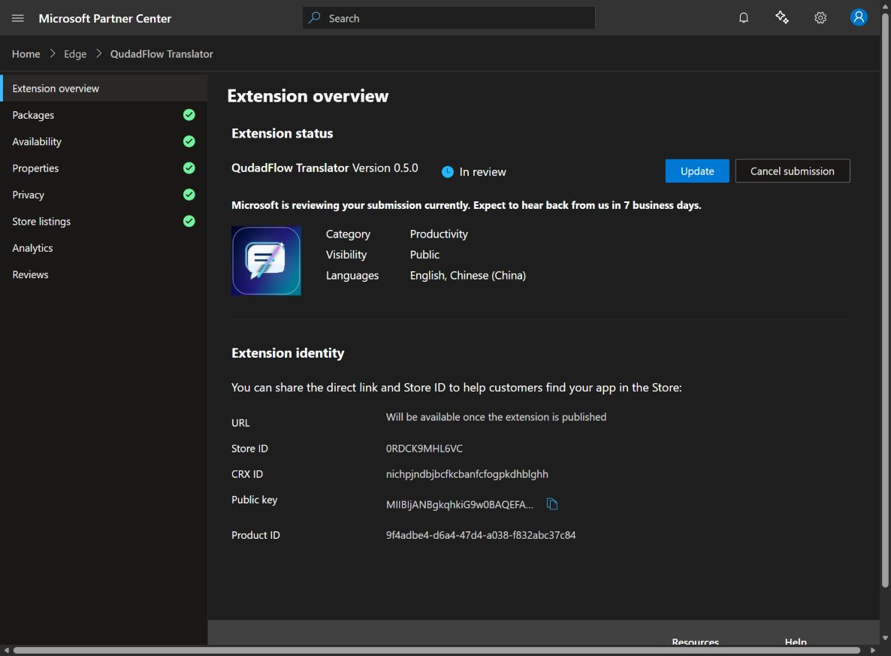

# QudadFlow Translator 0.5.0: Edge Add-ons submission

On October 21, 2026 (Asia/Shanghai), Microsoft Partner Center confirmed **Version 0.5.0 — In review** for the existing QudadFlow Translator product. The dashboard says to expect feedback in 7 business days; this is Microsoft's estimate, not an approval guarantee. Store approval and publication remain pending.

The previous 0.4.2 pending review was cancelled before submitting 0.5.0. The product identity is unchanged, and archived packages are retained.

- Store ID: `0RDCK9MHL6VC`
- CRX ID: `nichpjndbjbcfkcbanfcfogpkdhblghh`
- Runtime package: `qudadflow-translator-v0.5.0.zip`
- SHA256: `7bf6e593e4845123cf136131d7b0231b24c725da44c16d03c783a13521c361ca`
- Package validation: **Complete**
- Listings: **English** and **Chinese (China)**, both named **QudadFlow Translator**
- Store materials: existing logo and three webpage/settings images, plus the document-reader screenshot explicitly labeled as a simulated-translation demonstration
- Support: `lcf1249288484@outlook.com`
- Privacy: https://qudadd.github.io/qudadflow-translator/privacy.html

Certification notes explain the limited no-key MyMemory trial, the optional local simulated API, PDF/DOCX/TXT/Markdown document testing, saved API profiles, local parsing, and optional host permissions. The submitted text is preserved in [CERTIFICATION_NOTES_0.5.0.txt](CERTIFICATION_NOTES_0.5.0.txt).

The runtime had already passed 134 local checks and a separate limited live MyMemory sample. All 230 runtime files were verified identical across the ZIP, repository, and local trial directory. The user's private API configuration was not accessed or tested. See [verification scope](VERIFICATION.md).

