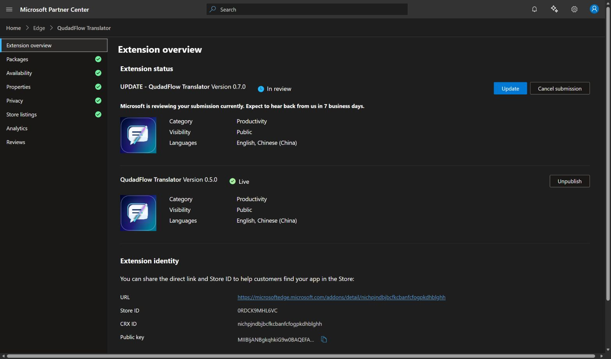

# QudadFlow Translator 0.7.0 submission

**Submitted successfully. Partner Center shows Version 0.7.0 — In review.** Confirmed at 2026-10-21T03:54:04.084Z on October 21, 2026. Microsoft displays an estimate of seven business days; approval and publication are not yet confirmed. The existing 0.5.0 remains Live and publicly visible.

- Product ID: 9f4adbe4-d6a4-47d4-a038-f832abc37c84
- Store ID: 0RDCK9MHL6VC
- CRX ID: nichpjndbjbcfkcbanfcfogpkdhblghh
- Store URL: https://microsoftedge.microsoft.com/addons/detail/nichpjndbjbcfkcbanfcfogpkdhblghh
- Uploaded package: qudadflow-translator-v0.7.0.zip (3,094,689 bytes, 247 runtime files)
- Runtime SHA256: 2416159864902e3077b425814ccba8c9458e1beccc3c9ccfc266dccc40bd0253
- Verification: 169 checks passed, zero failures, using isolated profiles and simulated APIs.

Both English and Chinese (China) descriptions were updated, retaining the English name QudadFlow Translator and existing logo. Privacy disclosures now cover explicit figure crops, source metadata, Skills, optional notebook memory and temporary captures. Authentication information, website content and web history (explicitly selected source titles/URLs, not passive history tracking) are disclosed. No remote code is used. Certification notes provide API requirements and local simulated review instructions without shared credentials.

The public English/Chinese 0.7.0 privacy policies returned HTTP 200 after the GitHub Pages deployment. Support: lcf1249288484@outlook.com.

The verified runtime files were copied to the existing unpacked installation. Windows Computer Use could not determine the current browser URL confidently and stopped, so an actual reload in the user's Edge was not confirmed. Reload the extension in edge://extensions to activate these files; no user API settings were accessed.

See [machine-readable record](submission-v0.7.0.json) and [submitted certification notes](CERTIFICATION_NOTES_0.7.0.txt).
