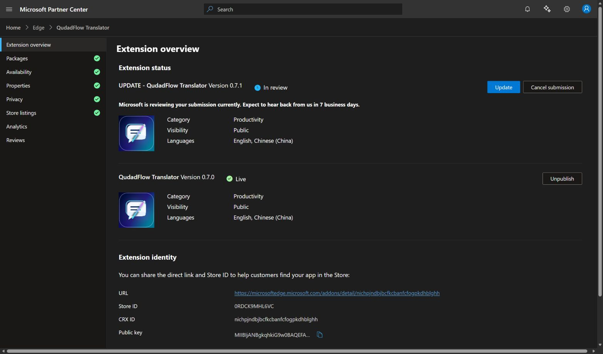

# QudadFlow Translator 0.7.1 submission

**Submitted successfully on October 21, 2026 (Asia/Shanghai). Partner Center confirms Version 0.7.1 — In review and Version 0.7.0 — Live.** Microsoft displays an estimate of seven business days. Version 0.7.1 approval and store publication are pending.

- Product ID: 9f4adbe4-d6a4-47d4-a038-f832abc37c84
- Store ID: 0RDCK9MHL6VC
- CRX ID: nichpjndbjbcfkcbanfcfogpkdhblghh
- Store URL: https://microsoftedge.microsoft.com/addons/detail/nichpjndbjbcfkcbanfcfogpkdhblghh
- Uploaded package: qudadflow-translator-v0.7.1.zip (3,104,482 bytes, 248 runtime files)
- Runtime SHA256: 647d84b01049ff275a7f8951dce431832ff3b048d9c2d6d124f8cc3c11b054b8
- Validation: 191 Edge checks passed, zero failures, with isolated profiles, synthetic keys and simulated APIs.
- GitHub release: https://github.com/qudadd/qudadflow-translator/releases/tag/v0.7.1
- Release source commit: c28cb62a966372f3e5ab157c7eebc20a6ced05f0

Partner Center verified the package as Complete. English and Chinese (China) descriptions were saved with the English product name QudadFlow Translator, new model/settings features and QQ community 1048123205. The final Publish action succeeded. The confirmed overview shows 0.7.1 In review and 0.7.0 Live. No cancellation or unpublish action was used.

GitHub contains the runtime ZIP, source ZIP, SHA256 checksums and package validation record. The runtime/source digests returned by GitHub match the local packages. GitHub Pages successfully built the release source commit; the homepage and English privacy policy returned HTTP 200. The homepage includes the QQ group.

The verified runtime files were copied to the existing unpacked installation. File synchronization is confirmed; browser reload/activation of that copy is not verified. Chrome upload remains separate and is deferred while Edge/GitHub are prioritized.

中文：0.7.1 已正式提交 Edge 审核，0.7.0 已上线；GitHub 0.7.1 已发布。微软后台预计七个工作日，提交成功不代表 0.7.1 已获批准。中英文商店说明及 QQ 群已同步。

See the [machine-readable record](submission-v0.7.1.json) and [exact submitted certification notes](CERTIFICATION_NOTES_SUBMITTED_0.7.1.txt).
